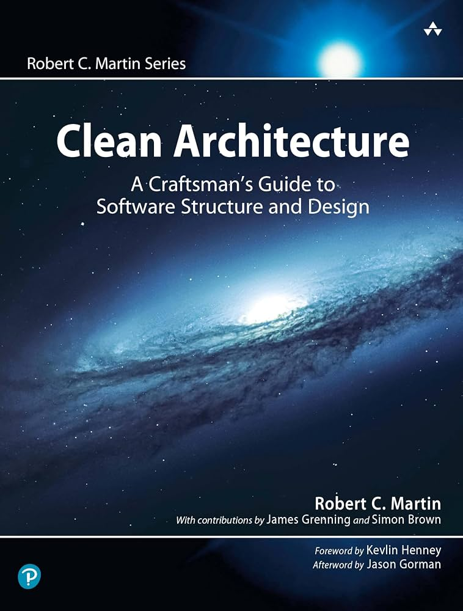
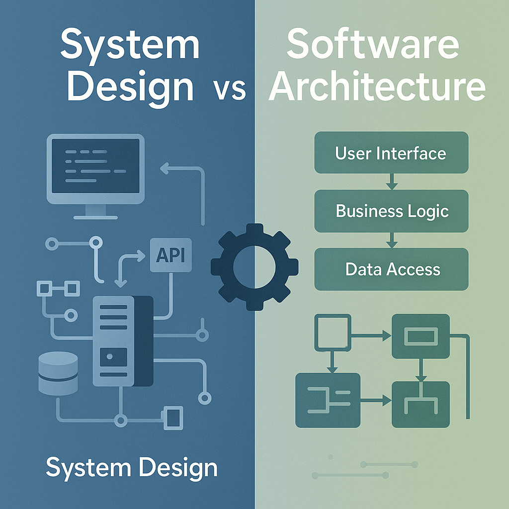
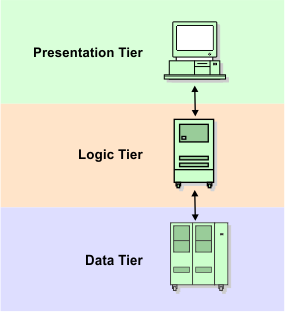

# Jour 1 : Qu'est-ce qu'une architecture ?




> En binôme, discutez 2 minutes :

- Pour vous, c'est quoi une **architecture** logicielle ?
- Avez-vous déjà travaillé sur un projet où ajouter une fonctionnalité simple prenait beaucoup de temps ? Pourquoi ?
- Avez-vous déjà eu du mal à tester une règle métier ? Qu'est-ce qui vous en empêchait ?

---

## Exercice : dessiner une architecture

> En groupe, 20 minutes.

Chaque groupe reçoit un produit connu : UberEats, Uber, LinkedIn, WhatsApp, etc...

- Dessinez **l'architecture** de ce produit, telle que vous l'imaginez
- Présentez votre schéma aux autres groupes en 3 minutes

<details>
<summary>Ce qu'on observe généralement</summary>

Certains groupes dessinent des serveurs, des bases de données, des files de messages, des services cloud.
D'autres dessinent des modules, des couches, des classes.

Les deux sont des architectures, mais elles ne répondent pas aux mêmes questions et ne se situent pas à la même échelle.

</details>

---

## Plusieurs architectures, plusieurs échelles

| Dimension             | Architecture de système                       | Architecture logicielle                        |
|-----------------------|-----------------------------------------------|------------------------------------------------|
| **Question**          | Quels systèmes, et comment communiquent-ils ? | Comment le code d'un système est-il organisé ? |
| **Éléments**          | Services, bases, files, API, cloud, réseau    | Modules, couches, composants, dépendances      |
| **Exemples**          | Microservices, event-driven, serverless       | N-tier, MVC, architecture en modules           |
| **Ce qu'on optimise** | Disponibilité, scalabilité, coûts, sécurité   | Testabilité, évolutivité, lisibilité           |



Dans ce module, on s'intéresse à l'**architecture logicielle** : l'organisation du code à l'intérieur d'une application.

### Quelques définitions

> *"L'architecture représente les décisions de conception significatives, où « significatif » se mesure au coût du changement."*
>
> Grady Booch

> *"L'architecture, ce sont les décisions qu'on aimerait prendre correctement dès le début, parce qu'elles sont difficiles à changer."*
>
> Martin Fowler

Une architecture est un ensemble de règles qui sert à :

- Résoudre des problèmes récurrents
- Faciliter les évolutions
- Fixer les décisions difficiles à changer

---

## L'architecture N-tier

Jusqu'au milieu des années 2000, l'architecture de référence était l'architecture **N-tier**, le plus souvent en 3 couches.



Chaque couche ne connaît que la couche située en dessous d'elle.

### Pourquoi c'était le standard

- Les applications étaient conçues à partir de la base de données : le schéma d'abord, le code ensuite
- Séparer l'interface, le métier et les données était un vrai progrès par rapport à du code sans organisation
- Les frameworks et les outils de l'époque poussaient vers ce découpage
- Les tests automatisés étaient peu pratiqués : on ne cherchait pas à tester le métier isolément

### Le sens des dépendances

Dans ce schéma, **le métier dépend des données**.

Pour exécuter une règle métier, il faut donc :

- Une connexion à la base de données
- Des tables créées et des données insérées
- Des objets dont la forme est imposée par le schéma de la base

---

## Kata : Bank Account

Vous travaillez sur une application de gestion de compte bancaire. Elle expose :

- Le **relevé de compte** : toutes les opérations, de la plus récente à la plus ancienne, avec le solde après chaque opération
- Le **dépôt**
- Le **retrait**

Exemple de relevé :

```text
Étant donné un dépôt de 1000 le 10 janvier 2021
Et un dépôt de 2000 le 15 janvier 2021
Et un retrait de 500 le 20 janvier 2021
Quand je consulte le relevé
Alors je vois :

| Date            | Montant | Solde |
| 20 janvier 2021 | -500    | 2500  |
| 15 janvier 2021 | 2000    | 3000  |
| 10 janvier 2021 | 1000    | 1000  |
```

Le projet est disponible en **C#** et en **TypeScript**. Choisissez votre stack.

### Étape 0 : Démarrer le projet

La base de données tourne en local avec le **Supabase CLI** (Postgres dans Docker). Elle est commune aux deux stacks.

Si ce n'est pas déjà fait, suivez d'abord la section [Avant le premier jour](../README.md#avant-le-premier-jour) du README principal.

```bash
# À lancer depuis la racine du dépôt
supabase start      # démarre Postgres en local
supabase db reset   # applique les migrations et les données de test
```

- Le projet de votre stack se trouve dans `jour-1/start/` : `csharp/` ou `ts/`
- Suivez son README pour lancer l'application
- Appelez le relevé de compte et vérifiez que vous obtenez l'exemple ci-dessus

### Étape 1 : Cartographier les dépendances

> En binôme, 20 minutes.

- Dessinez le graphe de dépendances entre les projets, modules et classes
- Où se trouvent les règles métier ?
- De quoi dépendent-elles ?

<details>
<summary>Dépendances identifiées</summary>

- Le contrôleur dépend du service métier
- Le service métier instancie lui-même le repository
- Le service métier lit directement l'heure système (`DateTime.UtcNow`, `new Date()`)
- Les objets manipulés par le métier sont les lignes de la base de données
- Le calcul du solde du relevé est fait dans le service, à partir du résultat de la requête

</details>

### Étape 2 : Tester une fonctionnalité existante

Le relevé de compte n'est pas testé. Écrivez des **tests de caractérisation** pour figer son comportement actuel.

Testez la couche métier directement : vos tests appellent le service, sans passer par l'API. Chaque test crée les données dont il a besoin et les supprime à la fin, sans compter sur les données de `supabase/seed.sql`.

> Rappel : un test de caractérisation teste ce que le code fait aujourd'hui, pas ce qu'il devrait faire.

Le projet contient déjà un test, qui s'appuie sur ces données. Avant de commencer, faites un dépôt sur le compte `1`, relancez ce test et observez le résultat. `supabase db reset` remet ensuite la base dans son état initial.

Les comportements à figer :

- Un compte sans opération a un relevé vide
- Le relevé liste les opérations de la plus récente à la plus ancienne, avec le solde après chacune
- Chaque opération est datée du moment où elle a été enregistrée
- Ce qui se passe quand on retire plus que le solde

Pour préparer leurs données, vos tests appellent le dépôt et le retrait du service. Ils partagent pourtant une seule base : on réserve donc un compte aux tests, et on le vide avant et après chaque test. Partez de ce squelette :

```csharp
using Bank.Data;
using Microsoft.AspNetCore.Mvc.Testing;
using Microsoft.Extensions.Configuration;
using Microsoft.Extensions.DependencyInjection;
using Supabase;

namespace Bank.Tests;

public class AccountServiceTests(WebApplicationFactory<Program> factory)
    : IClassFixture<WebApplicationFactory<Program>>, IAsyncLifetime
{
    private const int AccountId = 42;

    private readonly IConfiguration _configuration = factory.Services.GetRequiredService<IConfiguration>();

    public async ValueTask InitializeAsync() => await ClearOperationsAsync();

    public async ValueTask DisposeAsync() => await ClearOperationsAsync();

    // Vos tests ici, avec un service créé par new AccountService(_configuration)

    private async Task ClearOperationsAsync()
    {
        var client = new Client(_configuration["Supabase:Url"]!, _configuration["Supabase:Key"]!);

        await client.From<OperationRecord>()
            .Where(operation => operation.AccountId == AccountId)
            .Delete();
    }
}
```

xUnit crée une nouvelle instance de la classe pour chaque test : `InitializeAsync` s'exécute avant le test, et `DisposeAsync` après, même s'il échoue. `WebApplicationFactory` ne sert qu'à lire la configuration de l'application. En TypeScript, le squelette équivalent se trouve dans le README de `jour-1/start/ts`.

Pendant l'exercice, observez :

- Ce qu'il faut mettre en place pour exécuter un seul test
- Le temps d'exécution de votre suite de tests
- Ce qui se passe si deux tests s'exécutent en même temps

### Étape 3 : Ajouter une règle en TDD

Implémentez en **TDD** la règle suivante :

> Un utilisateur ne peut pas retirer plus que le solde disponible.

Procédez en deux temps :

1. **Avec la vraie base** : écrivez des tests qui appellent le service et utilisent la vraie base de données
2. **Avec des Seams** : isolez le service métier pour vérifier ce que la vraie base ne permet pas, comme les dates du relevé (voir le module Legacy Code)

<details>
<summary>Ce qui se passe généralement</summary>

- Avec la vraie base : les tests sont lents, dépendent de l'ordre d'exécution et demandent de nettoyer les données entre chaque test
- Avec des Seams : il en faut un pour le repository, un pour l'heure, parfois un pour la configuration, et la classe de test devient plus complexe que la classe testée

Dans les deux cas, une bonne partie du temps passe à contourner la structure du code plutôt qu'à écrire la règle.

</details>

---

## Les Seams comme symptôme

Les Seams servent à sécuriser du code legacy. Mais si chaque test d'une règle métier demande plusieurs Seams, le problème ne vient pas du test : c'est la structure du code qui empêche d'isoler le métier.

Un Seam est un contournement. En avoir besoin partout indique un problème de dépendances.

### Rétrospective

> Tous ensemble, 20 minutes.

Chaque groupe écrit sur des post-its ce qui l'a ralenti aujourd'hui. On regroupe les post-its au tableau.

<details>
<summary>Ce qu'on retrouve souvent</summary>

| Difficulté                                 | Cause                                           |
|--------------------------------------------|-------------------------------------------------|
| Impossible de tester sans base de données  | Le métier dépend de l'accès aux données         |
| Tests lents et fragiles                    | Chaque test traverse toute l'infrastructure     |
| La règle dépend de l'heure système         | L'heure est une dépendance cachée               |
| Le métier manipule des lignes de la base   | Le modèle est imposé par la base                |

Ces difficultés viennent toutes du sens des dépendances : le métier dépend de l'infrastructure.

</details>

---

## Conclusion

### Ce qu'on retient

- "Architecture" désigne des choses différentes selon l'échelle : solution ou logiciel
- Une architecture, ce sont les décisions difficiles à changer
- Le N-tier sépare présentation, métier et données, mais fait dépendre le métier des données
- Avec cette dépendance, tester une règle métier demande la base de données ou de nombreux Seams

---

## Ressources

- [Martin Fowler: Who Needs an Architect?](https://martinfowler.com/ieeeSoftware/whoNeedsArchitect.pdf)
- [Martin Fowler: Software Architecture Guide](https://martinfowler.com/architecture/)
- [Supabase CLI: développement local](https://supabase.com/docs/guides/local-development)
- [N-Tier Architecture](https://learn.microsoft.com/fr-fr/azure/architecture/guide/architecture-styles/n-tier)
- [Martin Fowler: Seam](https://martinfowler.com/bliki/LegacySeam.html)
