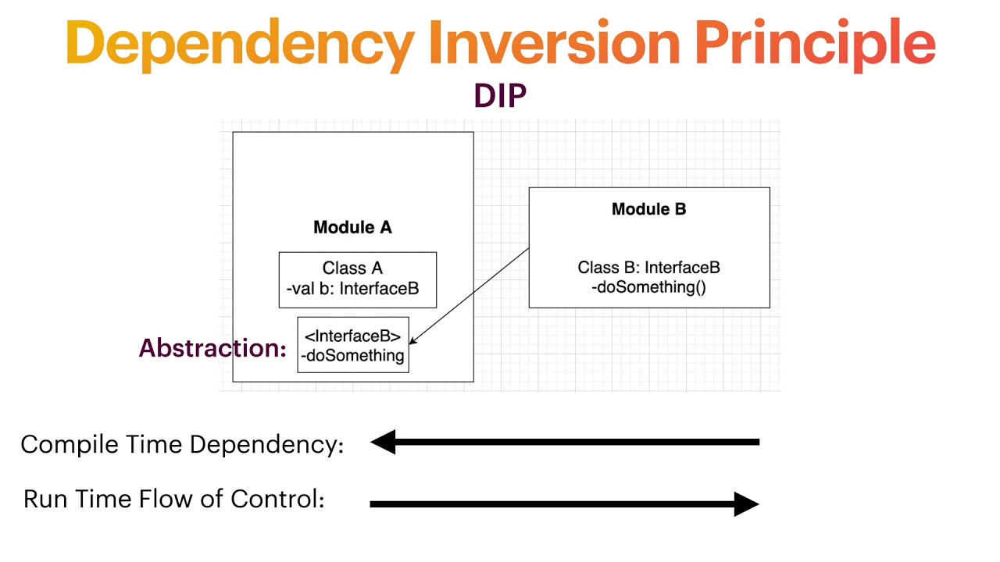
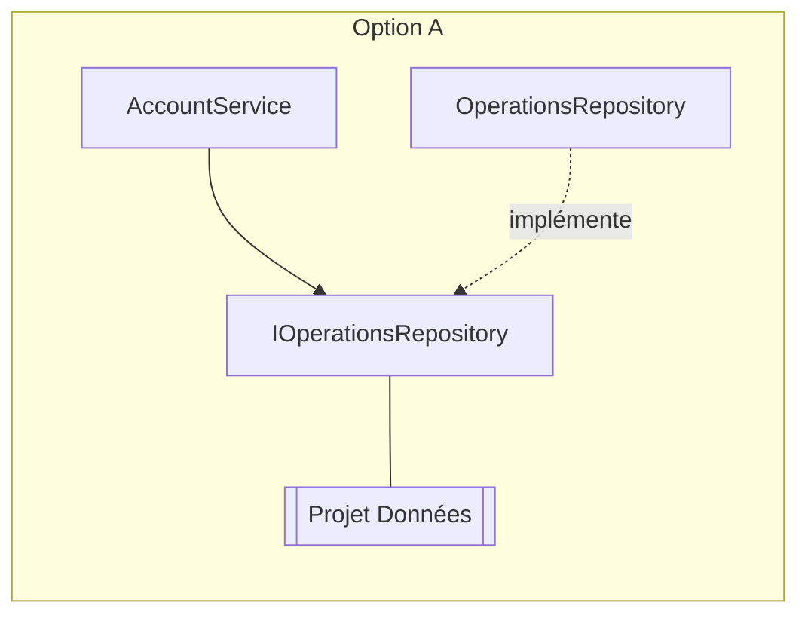
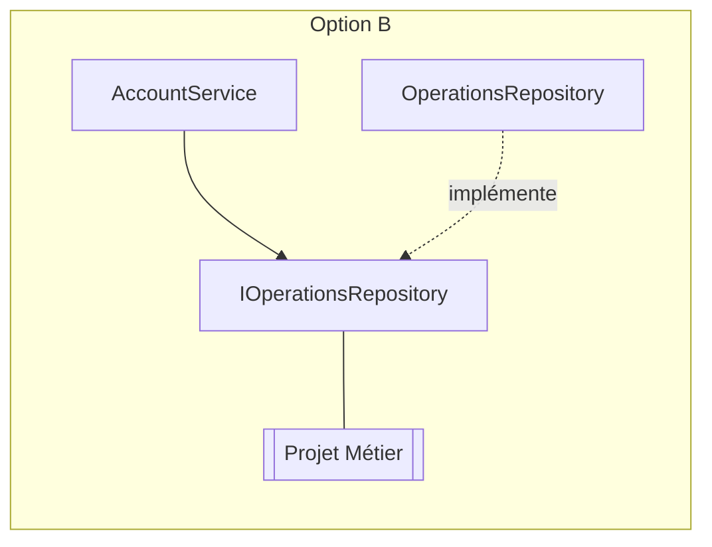
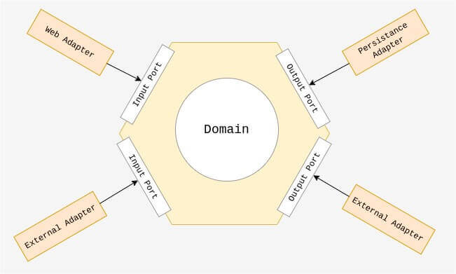
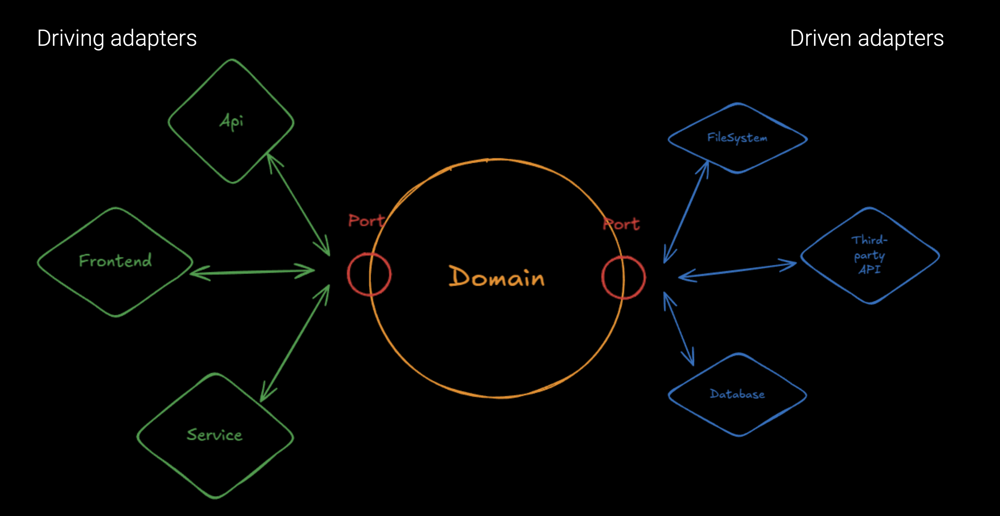

# Jour 2 : Mettre le domaine au centre

> En binôme, discutez 2 minutes :

- Que faudrait-il changer dans le code d'hier pour tester une règle métier sans base de données ?

---

## Tester sans la base de données

> En binôme, 10 minutes.

Reprenez la question de départ, à partir du code de `AccountService` :

- De quoi le service a-t-il besoin pour exécuter la règle du solde ?
- Que faudrait-il changer pour lui fournir autre chose que la vraie base de données ?

<details>
<summary>Réponse</summary>

Il faut trois choses :

1. **Une abstraction** : une interface, `IOperationsRepository`, décrit ce dont le service a besoin
2. **L'injection** : le service reçoit cette interface, au lieu de créer lui-même son repository
3. **Une doublure de test** (*test double*) : une implémentation écrite pour les tests, qui garde les opérations en mémoire

La règle se teste alors sans base de données. L'heure système se traite de la même façon.

Rien de tout cela ne dit où placer ces classes : cela fonctionne quel que soit le projet qui contient l'interface.

</details>

---

## Inverser les dépendances

On sait maintenant tester le métier sans base de données. Mais où placer l'interface ? Cette question n'a pas d'effet sur le test : elle décide du sens des dépendances.



> **Dependency Inversion Principle** (Robert C. Martin)
> - Les modules de haut niveau ne doivent pas dépendre des modules de bas niveau. Les deux doivent dépendre d'abstractions.
> - Les abstractions ne doivent pas dépendre des détails. Les détails doivent dépendre des abstractions.

Ce principe ne demande pas seulement une interface : il faut aussi se demander **à qui elle appartient**.

### Exercice : où vit l'interface ?

> En binôme, 15 minutes.

Reprenons l'interface `IOperationsRepository`. Comparez ces deux emplacements :





- Dans chaque option, quel projet référence l'autre ?
- Dans quelle option peut-on compiler le métier sans le projet de données ?

<details>
<summary>Réponse</summary>

- **Option A** : l'interface appartient à la couche données. Le métier référence toujours la couche données. Il y a une interface, mais le sens des dépendances est le même qu'hier.
- **Option B** : l'interface appartient au métier. C'est la couche données qui référence le métier pour implémenter l'interface. La dépendance est inversée.

Seule l'option B permet de compiler le métier sans le projet de données : c'est ce qu'apporte l'inversion de dépendances.

Dans l'option B, le métier décrit ce dont il a besoin avec son propre vocabulaire, et l'infrastructure s'y conforme.

</details>

---

## Pourquoi des architectures centrées sur le domaine ?

> En binôme, 45 minutes de recherche, puis 5 minutes de présentation par binôme.

Une architecture **centrée sur le domaine** place le code métier au centre : il ne dépend d'aucune technique, et c'est la technique qui dépend de lui.

Qu'est-ce que cela change concrètement par rapport au N-tier ? Chaque binôme reçoit une demande d'évolution du Bank Kata :

| Sujet                                                                                                               |
|---------------------------------------------------------------------------------------------------------------------|
| La table `operations` est découpée en `deposits` et `withdrawals`, sans que les tests des règles métier ne changent |
| Le SDK d'accès aux données sort une version majeure qui change la façon d'écrire les requêtes et les modèles        |
| Les opérations quittent Supabase pour l'API REST d'un autre service de la banque                                    |
| Une autre équipe veut réutiliser les règles de retrait dans son application, sans embarquer Supabase                |
| Plus personne ne doit pouvoir appeler le SDK depuis une règle métier, même sous la pression d'une livraison         |

Pour votre demande :

1. Partez du code N-tier (`jour-1/start/`), en lui ajoutant l'option A de l'exercice précédent : que faudrait-il modifier ? Quels projets sont touchés ? Qu'est-ce qui bloque, et d'où vient ce blocage ?
2. Recherchez comment une architecture centrée sur le domaine traite ce cas
3. Présentez aux autres ce qui change entre les deux, et ce que cela coûte, avec un exemple concret tiré du Bank Kata

<details>
<summary>Synthèse</summary>

Ces bénéfices ont une origine commune : le domaine ne dépend de rien, et le reste dépend du domaine.

- Les tests du domaine ne connaissent ni le schéma de la base ni le SDK
- Changer de stockage revient à écrire un nouvel adapter, sans toucher au domaine
- Le domaine se réutilise sans embarquer l'infrastructure
- Le compilateur empêche le domaine d'appeler l'infrastructure

</details>

---

## L'architecture hexagonale

Proposée par **Alistair Cockburn en 2005**, aussi appelée **Ports & Adapters**.



<details>
<summary>Cela vous semble familier?</summary>



</details>

### Le vocabulaire

| Terme                       | Définition                                                                  |
|-----------------------------|-----------------------------------------------------------------------------|
| **Domaine**                 | Les règles métier, sans dépendance technique                                |
| **Port entrant** (driving)  | Ce que l'application propose au monde extérieur                             |
| **Port sortant** (driven)   | Ce dont l'application a besoin du monde extérieur, décrit par le domaine    |
| **Adapter**                 | Le code qui fait le lien entre un port et une technologie                   |

### Pourquoi un hexagone ?

La forme n'a pas d'importance : Cockburn voulait s'éloigner du schéma en couches empilées. Ce qui compte :

- Il n'y a pas de haut ni de bas, seulement un **intérieur** (le domaine) et un **extérieur** (le reste)
- Les dépendances vont de l'extérieur vers l'intérieur
- Les tests sont un adapter comme les autres : ils pilotent l'application par ses ports entrants

### N-tier et hexagonal côte à côte

Reprenons l'option A de l'exercice sur l'interface, appliquée au retrait en N-tier :

```csharp
// Bank.Data : l'interface appartient aux données et parle leur langage
public interface IOperationsRepository
{
    Task<IReadOnlyList<OperationRecord>> GetOperationsAsync(int accountId);
    Task InsertOperationAsync(int accountId, decimal amount, DateTime date);
}

// Bank.Business : référence Bank.Data, à cause de l'interface et de OperationRecord
public class AccountService(IOperationsRepository repository)
{
    public async Task WithdrawAsync(int accountId, decimal amount)
    {
        var operations = await repository.GetOperationsAsync(accountId);

        if (amount > operations.Sum(operation => operation.Amount))
        {
            throw new InsufficientFundsException();
        }

        await repository.InsertOperationAsync(accountId, -amount, DateTime.UtcNow);
    }
}
```

Le service reçoit son repository par injection, mais le métier dépend toujours des données. Voici le même retrait en hexagonal :

```csharp
// Bank.Domain : ne référence aucun projet, l'interface appartient au domaine et parle son langage
public interface IOperations
{
    Task<Account> AccountOfAsync(AccountId accountId);
    Task SaveAsync(Account account);
}

public interface IForWithdrawing
{
    Task WithdrawAsync(AccountId accountId, Amount amount);
}

public class AccountService(IOperations operations, IClock clock) : IForWithdrawing
{
    public async Task WithdrawAsync(AccountId accountId, Amount amount)
    {
        var account = await operations.AccountOfAsync(accountId);
        account.Withdraw(amount, clock.Now());
        await operations.SaveAsync(account);
    }
}

// Bank.Adapters.Supabase : référence Bank.Domain
public class SupabaseOperations : IOperations
{
    // traduit les comptes et les opérations du domaine en lignes de la base, et inversement
}
```

| Question                                       | N-tier avec une interface           | Hexagonal                              |
|------------------------------------------------|-------------------------------------|----------------------------------------|
| À qui appartient l'interface ?                 | Aux données                         | Au domaine                             |
| Quel vocabulaire utilise-t-elle ?              | Celui de la base : lignes, colonnes | Celui du métier : compte, montant      |
| Quel projet référence l'autre ?                | Le métier référence les données     | L'adapter référence le domaine         |
| Où se trouve la règle ?                        | Dans le service                     | Dans le domaine                        |
| Peut-on compiler le métier sans les données ?  | Non                                 | Oui                                    |

Les deux versions utilisent une interface et de l'injection. Ce qui les sépare, c'est le sens des dépendances : dans l'hexagone, le domaine ne connaît rien de l'extérieur.

Le port des opérations est asynchrone : il mène à un système externe, donc à des appels réseau. Le domaine reste synchrone, comme `IClock`, qui ne fait aucun appel externe.

---

## Kata : concevoir l'hexagone

### Étape 1 : Design de l'Hexagone

> En mob, 30 minutes. Pas de code.

À partir du code d'hier :

- Listez les **ports entrants** : que propose l'application ?
- Listez les **ports sortants** : de quoi le métier a-t-il besoin ?
- Listez les **adapters** existants
- Nommez chaque port avec le vocabulaire du métier plutôt qu'avec celui de la technique

<details>
<summary>Une proposition</summary>

| Type          | Élément                                                     |
|---------------|-------------------------------------------------------------|
| Port entrant  | Déposer, Retirer, Consulter le relevé                       |
| Port sortant  | Les opérations du compte (lire, enregistrer)                |
| Port sortant  | L'horloge                                                   |
| Adapter       | Contrôleur REST (entrant), repository Supabase (sortant)    |
| Adapter       | Opérations en mémoire, horloge fixe (sortants, pour les tests) |

`IOperationsRepository` décrit une technique. `IOperations` ou `AccountHistory` décrit un besoin du métier.

</details>

### Étape 2 : Construire le domaine en TDD

`jour-2/hexagon/` contient, pour chaque stack, un projet vide pour le domaine et son projet de tests, sans aucune référence à l'infrastructure.

Développez-y le domaine en TDD :

- Un dépôt augmente le solde
- Un retrait diminue le solde
- Un retrait supérieur au solde est refusé
- Le relevé liste les opérations de la plus récente à la plus ancienne, avec le solde après chaque opération
- L'historique d'un compte ne change jamais : seules ses nouvelles opérations sont enregistrées

Pour les ports sortants, écrivez vous-mêmes des adapters en mémoire, sans framework de mock.

Déclarez aussi un port entrant par fonctionnalité, tous implémentés par un même service. Pour l'instant, seuls vos tests les appellent : les autres adapters entrants seront branchés demain.

Comparez le temps d'exécution de ces tests avec ceux d'hier.

---

## Conclusion

### Ce qu'on retient

- Pour tester une règle sans base de données, il suffit d'une abstraction et d'une doublure de test
- L'inversion de dépendances répond à une autre question : l'interface doit appartenir au métier
- Une architecture centrée sur le domaine fait dépendre la technique du métier, et non l'inverse
- L'architecture hexagonale sépare un intérieur (le domaine) d'un extérieur, reliés par des ports
- Les ports entrants décrivent ce que propose l'application, les ports sortants ce dont elle a besoin
- Les tests pilotent l'application comme n'importe quel autre adapter

### Questions

- Quelle différence avez-vous constatée entre écrire les tests d'hier et ceux d'aujourd'hui ?
- Qu'est-ce qui a été difficile à nommer ?
- Quels éléments du code d'hier ne savez-vous pas encore où placer ?

---

## Ressources

- [Alistair Cockburn : Hexagonal Architecture](https://alistair.cockburn.us/hexagonal-architecture/)
- [Robert C. Martin : The Dependency Inversion Principle](https://web.archive.org/web/20110714224327/http://www.objectmentor.com/resources/articles/dip.pdf)
- [Herberto Graça : Ports & Adapters Architecture](https://herbertograca.com/2017/09/14/ports-adapters-architecture/)
