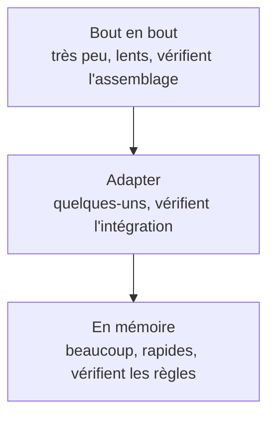

# Jour 3 : Refactorer vers l'hexagone

> En binôme, discutez 2 minutes :

- Le domaine construit hier fonctionne en mémoire. Que manque-t-il pour qu'il remplace le service N-tier ?
- Dans quel ordre procéderiez-vous pour migrer sans casser l'application ?

---

## Kata : migrer l'application

### Point de départ

`jour-3/start/` contient, pour chaque stack, le code N-tier avec les tests de caractérisation et la règle du solde du premier jour, et le domaine construit hier, dans son propre projet avec ses tests. Le guide `jour-2/solution.<stack>.md` reprend sa construction pas à pas.

Partez de ce projet. Si vous préférez garder votre domaine, remplacez celui qui est fourni par le vôtre.

### Étape 1 : Brancher le domaine

> En mob, rotation toutes les 10 minutes.

Remplacez progressivement le service N-tier par le domaine construit hier :

1. Créez les adapters sortants : un adapter Supabase pour le port des opérations, et un adapter pour l'horloge système
2. Faites passer les tests d'`AccountService` par le service du domaine et l'adapter Supabase, sans changer ce qu'ils vérifient
3. Faites appeler les ports entrants par le contrôleur de `Bank.Api`, qui devient votre adapter REST
4. Supprimez l'ancien service métier
5. Vérifiez que les tests de caractérisation écrits le premier jour passent toujours

<details>
<summary>Organisation possible</summary>

Les projets existants changent de rôle, et leur nom peut le refléter :

| Avant           | Après                    | Contenu                            |
|-----------------|--------------------------|------------------------------------|
| `Bank.Api`      | `Bank.Adapters.Rest`     | Contrôleurs (adapter entrant)      |
| `Bank.Data`     | `Bank.Adapters.Supabase` | Adapter du port des opérations     |
| `Bank.Business` | Supprimé                 | Remplacé par le domaine            |
| `Bank.Domain`   | `Bank.Domain`            | `Models`, `Ports`, `Services`      |

L'horloge système n'a pas de lien avec Supabase : à vous de décider où placer son adapter.

Renommer les projets est facultatif. La contrainte à respecter : `Bank.Domain` ne référence aucun autre projet.

</details>

### Étape 2 : Des règles qui dépendent du temps

> En deux mobs, puis présentation à l'autre mob.

Chaque mob implémente une règle en TDD, à partir du code de l'étape 1 :

| Mob   | Règle                                                                  |
|-------|------------------------------------------------------------------------|
| Mob A | Un utilisateur ne peut pas retirer plus de 2500 sur 24 heures glissantes |
| Mob B | Entre 22 heures et 6 heures, un retrait ne peut pas dépasser 500       |

Présentez ensuite votre règle à l'autre mob :

- Où se trouve-t-elle, et comment l'avez-vous testée ?
- Quels cas limites avez-vous identifiés ?
- Combien de Seams cette règle aurait-elle demandé dans le code du premier jour ?

Si le temps le permet, implémentez la règle de l'autre mob.

Chaque mob repart du code de l'étape 1 : partagez-le, par exemple sur une branche Git. Chaque mob continue ensuite sur son propre code.

### Étape 3 : Un nouveau point d'entrée, l'écran du DAB

Ajoutez un adapter entrant qui simule l'écran d'un distributeur automatique en ligne de commande. Il permet de :

- Déposer
- Retirer
- Afficher le relevé et le solde

Combien de lignes du domaine avez-vous modifiées ?

### Pour aller plus loin : Un contrat pour les adapters

Vos tests remplacent la vraie base par un adapter en mémoire. Si les deux ne se comportent pas de la même façon, ces tests passent pour de mauvaises raisons.

Un **test de contrat** décrit ce qu'on attend d'un port, quel que soit l'adapter qui l'implémente :

1. Écrivez des tests qui ne connaissent que le port des opérations, jamais un adapter en particulier. Ils reçoivent le port à tester, par exemple avec une classe de base abstraite en C#, ou une fonction en TypeScript
2. Décrivez ce que tout adapter doit garantir. Par exemple : un compte sans opération a un historique vide, une opération enregistrée se retrouve dans l'historique, et enregistrer un compte n'ajoute que ses nouvelles opérations
3. Exécutez ces mêmes tests deux fois : une fois avec l'adapter en mémoire, une fois avec l'adapter Supabase

La classe abstraite contient les tests, et chaque classe qui en hérite fournit son adapter. xUnit exécute tous les tests hérités pour chacune d'elles :

```csharp
public abstract class OperationsContract
{
    protected abstract IOperations Operations { get; }

    [Fact]
    public async Task AnAccountWithoutOperations_HasAnEmptyHistory()
    {
        var account = await Operations.AccountOfAsync(new AccountId(1));

        Assert.Empty(account.History);
    }
}

public class InMemoryOperationsContractTests : OperationsContract
{
    protected override IOperations Operations { get; } = new InMemoryOperations();
}
```

Cherchez ensuite ce que l'adapter Supabase garantit, et que l'adapter en mémoire ne garantit peut-être pas. Trouvez-vous une différence entre eux ?

---

## Comparer le premier jour et aujourd'hui

> En binôme, 20 minutes, puis comparez avec les autres binômes.

Repensez à la règle du solde du premier jour et comparez-la à celle de votre mob :

- Laquelle a été la plus simple à écrire et à tester ? Pourquoi ?
- Où avez-vous passé le plus de temps dans chaque cas : sur la règle, ou sur la mise en place des tests ?
- Que faut-il démarrer pour exécuter un test aujourd'hui ?

Vos tests forment maintenant trois niveaux :

| Niveau       | Ce qu'il vérifie                                                 | Ce qu'il faut démarrer   |
|--------------|------------------------------------------------------------------|--------------------------|
| En mémoire   | Les règles métier et les adapters entrants, comme l'écran du DAB | Rien                     |
| Adapter      | Que l'adapter Supabase parle correctement à la base              | La base                  |
| Bout en bout | Que tout est correctement assemblé                               | La base et l'application |

- Combien de tests avez-vous à chaque niveau ? Pourquoi cette répartition ?
- Au premier jour, à quel niveau se trouvaient vos tests ?

<details>
<summary>La pyramide des tests</summary>

Cette répartition porte un nom : la **pyramide des tests**, popularisée par Mike Cohn dans *Succeeding with Agile*.



Plus on monte, plus un test est lent, coûteux à maintenir et difficile à diagnostiquer. On place donc chaque vérification le plus bas possible.

Au premier jour, chaque test passait par la vraie base : il n'y avait aucun test à la base de la pyramide. C'est la structure de l'application qui l'empêchait, et c'est l'hexagone qui rend cette base possible.

</details>
- Qu'est-ce que l'ajout de l'écran du DAB vous aurait demandé dans le code du premier jour ?
- Combien de fichiers et de projets l'application compte-t-elle maintenant ? Qu'est-ce que l'hexagone vous a coûté ?

---

## Conclusion

### Ce qu'on retient

- On peut migrer vers l'hexagone progressivement, en s'appuyant sur des tests de caractérisation
- Les dépendances externes ne se limitent pas à la base de données : l'heure système en est une aussi
- L'hexagone rend possible la pyramide des tests : beaucoup de tests en mémoire, quelques tests sur la vraie base, très peu de bout en bout
- Un nouveau point d'entrée s'ajoute sous forme d'adapter, sans modifier le domaine
- L'hexagone a aussi un coût : plus de fichiers, plus de projets, plus de conversions entre objets

### Questions

- Quelle étape de la migration a été la plus délicate ?
- Où avez-vous hésité à placer du code ?
- Le gain en testabilité vous semble-t-il valoir le coût en structure ?

---

## Ressources

- [Alistair Cockburn : Hexagonal Architecture](https://alistair.cockburn.us/hexagonal-architecture/)
- [Martin Fowler : Strangler Fig Application](https://martinfowler.com/bliki/StranglerFigApplication.html)
- [Ham Vocke : The Practical Test Pyramid](https://martinfowler.com/articles/practical-test-pyramid.html)
