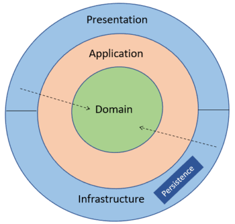
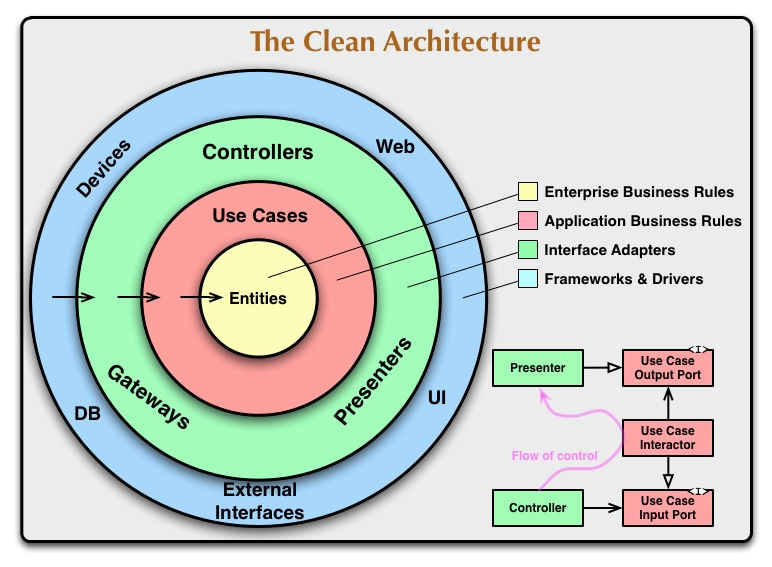

# Jour 4 : Onion, Clean Architecture et tests d'architecture

> En binôme, discutez 2 minutes :

- Avez-vous déjà entendu parler d'architecture Onion ou de Clean Architecture ? Qu'en savez-vous ?
- Dans votre code d'hier, quelles classes contiennent des règles métier, et lesquelles se contentent d'enchaîner des étapes ?

---

## Recherche : Hexagonale, Onion, Clean

> Toute la classe, 30 minutes.

Tous ensemble, étudiez ces trois architectures et construisez un schéma de chacune au tableau :

| Architecture   | Auteur             | Année |
|----------------|--------------------|-------|
| **Hexagonale** | Alistair Cockburn  | 2005  |
| **Onion**      | Jeffrey Palermo    | 2008  |
| **Clean**      | Robert C. Martin   | 2012  |

Questions à traiter :

- Quelles sont les couches ou zones ?
- Dans quel sens vont les dépendances ?
- Qu'apporte-t-elle par rapport à la précédente ?
- Où placeriez-vous les classes du Bank Kata ?

---

## L'architecture Onion

L'hexagone distingue un intérieur et un extérieur, mais ne dit rien de l'organisation de l'intérieur. L'architecture Onion découpe cet intérieur en couches concentriques :



| Couche             | Contenu                                                                  | Bank Kata                                                        |
|--------------------|--------------------------------------------------------------------------|------------------------------------------------------------------|
| **Domain**         | Les objets du métier et leurs règles                                     | `Account`, `Amount`, `Operation`                                 |
| **Application**    | L'enchaînement des étapes d'un cas d'utilisation, et les interfaces dont il a besoin | `Withdraw`, `Deposit`, `PrintStatement`, `IOperations`, `IClock` |
| **Infrastructure** | L'accès au monde extérieur, comme la persistance                         | Adapter Supabase, horloge système                                |
| **Presentation**   | Ce qui expose l'application à ses utilisateurs                           | Contrôleurs REST, écran du DAB                                   |

Une couche ne dépend que des couches situées plus au centre.

Ce découpage est la forme la plus répandue aujourd'hui. Dans son article de 2008, Jeffrey Palermo laisse le nombre de couches ouvert : il distingue un Domain Model au centre, entouré d'autres couches, et place les interfaces de repository juste autour de ce modèle.

Dans votre code, `AccountService` fait encore tout : il enchaîne les étapes de chaque action. Dans une Onion, chacune de ces actions devient un cas d'utilisation de la couche Application.

---

## La Clean Architecture

Présentée par Robert C. Martin dans un article en 2012, puis dans le livre *Clean Architecture* en 2017. Martin la décrit comme une synthèse de plusieurs architectures existantes, dont l'hexagonale et l'Onion.



### Les cercles

| Cercle                   | Contenu                                                                        | Bank Kata                                         |
|--------------------------|--------------------------------------------------------------------------------|---------------------------------------------------|
| **Entities**             | Les règles métier de l'entreprise, valables quelle que soit l'application      | Un compte ne peut pas être débité au-delà de son solde |
| **Use Cases**            | Les règles propres à cette application : ce qu'un utilisateur peut faire, étape par étape | Retirer : charger le compte, débiter, enregistrer, renvoyer le nouveau solde |
| **Interface Adapters**   | La conversion entre le format des cas d'utilisation et celui de l'extérieur    | Contrôleurs, mise en forme du relevé, implémentation de `IOperations` |
| **Frameworks & Drivers** | Les outils eux-mêmes                                                           | ASP.NET, Supabase, la console du DAB              |

### La règle de dépendance

> *"Les dépendances du code source ne peuvent pointer que vers l'intérieur."*
>
> Robert C. Martin

Un élément d'un cercle intérieur ne connaît aucun nom déclaré dans un cercle extérieur : ni classe, ni fonction, ni format de données.

Le nombre de cercles n'est pas fixé. Martin précise que quatre est un exemple : on peut en avoir plus, tant que la règle de dépendance est respectée.

### Ce que la Clean Architecture ajoute à l'hexagone

L'hexagone fixe une seule règle : le domaine au centre, les dépendances vers lui. La Clean Architecture garde cette règle et ajoute des conventions sur l'organisation du code.

**Deux niveaux de règles métier.** Les **entités** portent les règles qui existeraient même sans application (une banque interdit le découvert, avec ou sans logiciel). Les **cas d'utilisation** portent les règles qui n'existent que parce que l'application existe (au DAB, un retrait affiche ensuite le nouveau solde).

**Un cas d'utilisation, une classe.** Chaque action de l'utilisateur a sa propre classe, et le code est regroupé par ce qu'il fait, et non par ce qu'il est. Un dossier par cas d'utilisation contient tout ce qui lui est propre. En ouvrant le projet, on lit la liste de ce que fait l'application : `Deposit`, `Withdraw`, `PrintStatement`. Martin parle d'une architecture qui "crie" son métier (*Screaming Architecture*).

**Des structures dédiées aux frontières.** Les données qui entrent dans un cas d'utilisation et qui en sortent sont des structures simples, sans comportement (un *Request Model* et un *Response Model*). Les entités ne sortent pas du centre : un contrôleur ne manipule jamais un `Account`. On peut alors modifier une entité sans casser le contrat de l'API ou l'écran du DAB.

**La présentation séparée.** La mise en forme (dates, montants, messages) est confiée à un **Presenter**, dans le cercle Interface Adapters. Dans la version décrite par Martin, le cas d'utilisation ne renvoie pas de résultat : il transmet ce résultat au Presenter via une interface. C'est un fonctionnement différent de ce qu'on a fait jusqu'ici, avec ses propres compromis, et beaucoup d'équipes choisissent plutôt de faire renvoyer un Response Model par le cas d'utilisation. L'exemple ci-dessous suit cette seconde approche. Le fonctionnement de Martin est un sujet à explorer une fois l'hexagone bien maîtrisé.

### Exemple : le relevé de compte

**Entities** : le compte et ses règles, sans aucune notion d'application.

```csharp
public class Account(AccountId id, IReadOnlyList<Operation> history)
{
    public Amount Balance => AllOperations.Aggregate(Amount.Zero, (balance, operation) => balance + operation.Amount);

    public void Withdraw(Amount amount, DateTime date)
    {
        // vérifie le solde et les limites de retrait, puis ajoute l'opération aux nouvelles opérations
    }

    public IReadOnlyList<StatementLine> Statement()
    {
        // opérations de la plus récente à la plus ancienne, avec le solde après chacune
    }
}
```

**Use Cases** : une classe par action, avec ses propres structures d'entrée et de sortie. `Account` et `StatementLine` ne sortent pas de ce cercle.

```csharp
public record PrintStatementRequest(int AccountId);

public record PrintStatementLine(DateTime Date, decimal Amount, decimal Balance);

public record PrintStatementResponse(IReadOnlyList<PrintStatementLine> Lines, decimal Balance);

public class PrintStatementUseCase(IOperations operations) : IForPrintingStatements
{
    public async Task<PrintStatementResponse> PrintStatementAsync(PrintStatementRequest request)
    {
        var account = await operations.AccountOfAsync(new AccountId(request.AccountId));

        var lines = account.Statement()
            .Select(line => new PrintStatementLine(line.Date, line.Amount.Value, line.Balance.Value))
            .ToList();

        return new PrintStatementResponse(lines, account.Balance.Value);
    }
}
```

**Interface Adapters** : un presenter par format de sortie, qui ne connaît que le Response Model.

```csharp
public static class StatementJsonPresenter
{
    public static IReadOnlyList<StatementLineResponse> Present(PrintStatementResponse response) =>
        response.Lines
            .Select(line => new StatementLineResponse(line.Date, line.Amount, line.Balance))
            .ToList();
}

public static class StatementAtmPresenter
{
    public static string Present(PrintStatementResponse response)
    {
        var lines = response.Lines
            .Select(line => $"{line.Date:yyyy-MM-dd} | {line.Amount} | {line.Balance}")
            .Append($"Balance: {response.Balance}");

        return string.Join(Environment.NewLine, lines);
    }
}
```

```csharp
// Contrôleur REST
[HttpGet("operations")]
public async Task<IReadOnlyList<StatementLineResponse>> GetStatement(int accountId)
{
    var response = await printingStatements.PrintStatementAsync(new PrintStatementRequest(accountId));

    return StatementJsonPresenter.Present(response);
}

// Écran du DAB
var response = await printingStatements.PrintStatementAsync(new PrintStatementRequest(accountId.Value));

await output.WriteLineAsync(StatementAtmPresenter.Present(response));
```

Ce que cet exemple change par rapport au code du jour 3 :

- Pour le relevé, le contrôleur et l'écran du DAB ne manipulent plus d'objets du domaine. On peut transformer `Operation` ou `Amount` sans toucher à ces deux affichages.
- La mise en forme des dates et des montants est sortie du cas d'utilisation. Chaque format d'affichage a son presenter, testable seul.
- `PrintStatementUseCase` se teste en vérifiant un Response Model, sans analyser de JSON ni de texte.
- En contrepartie, on a ajouté trois records et deux presenters, et une conversion entre `StatementLine` et `PrintStatementLine`.

### Correspondance avec l'hexagone

| Hexagonal          | Clean Architecture                               |
|--------------------|--------------------------------------------------|
| Domaine            | Entities                                         |
| Ports entrants     | Use Cases                                        |
| Ports sortants     | Interfaces déclarées dans Use Cases (gateways)   |
| Adapters entrants  | Controllers, Presenters                          |
| Adapters sortants  | Gateways (implémentations des repositories)      |
| Technologies       | Frameworks & Drivers                             |

L'Onion et la Clean Architecture placent les ports sortants au même endroit : dans le kata, `IOperations` et `IClock` vont dans `Bank.Application`.

### Le coût

- **Plus de types.** Une classe par cas d'utilisation, des structures d'entrée et de sortie pour chacun, des presenters.
- **Plus de conversions.** Une même donnée passe d'entité à Response Model, puis à ce qu'affiche l'écran ou l'API. Chaque conversion est du code à écrire, à tester et à maintenir.
- **Les templates.** Il existe de nombreux templates "Clean Architecture" qui imposent des dossiers et des projets. Ils donnent la structure sans la règle de dépendance : on retrouve vite une entité utilisée directement dans un contrôleur, rangée dans le bon dossier.
- **Le métier pauvre.** Quand un cas d'utilisation se résume à lire et écrire une ligne en base, la plupart de ces classes ne font que transmettre des données.

---

## Kata : de l'hexagone à la Clean Architecture

### Point de départ

`jour-4/start/` contient, pour chaque stack, l'application migrée vers l'hexagone, avec les limites de retrait et l'écran du DAB. Le guide `jour-3/solution.<stack>.md` reprend ces étapes pas à pas.

Partez de ce projet, ou continuez dans votre code d'hier. Le comportement de l'application ne change pas : les tests doivent passer après chaque étape.

### Étape 1 : Séparer l'application du domaine

> En mob, rotation toutes les 10 minutes.

1. Créez un projet `Bank.Application`, qui référence `Bank.Domain`
2. Déplacez-y les ports et `AccountService`, avec leurs tests : `Bank.Domain` ne garde que les entités et leurs règles
3. Remplacez `AccountService` par un dossier par cas d'utilisation : `Deposit/`, `Withdraw/`, `PrintStatement/`. Chaque dossier contient tout ce qui lui est propre, dont son port entrant et la classe qui l'implémente

### Étape 2 : Des structures dédiées aux frontières

Appliquez l'exemple du relevé de compte à votre code :

1. Faites entrer et sortir du cas d'utilisation du relevé un Request Model et un Response Model, rangés dans son dossier
2. Ajoutez un presenter pour l'API et un autre pour l'écran du DAB

Le JSON de l'API et l'affichage du relevé ne changent pas.

Puis implémentez en TDD une règle propre à l'application :

> Après un retrait, l'écran du DAB affiche le nouveau solde.

Le cas d'utilisation du retrait renvoie ce solde dans un Response Model, rangé dans son dossier. L'API, elle, ne change pas.

Pour finir, discutez :

- Qu'est-ce que chaque étape vous a apporté ?
- Faudrait-il aussi des structures dédiées pour ce qui entre dans `Deposit` et `Withdraw` ?

---

## Tests d'architecture

### Le principe

Une architecture décrite dans un document ou dans un schéma n'empêche personne de la contourner, par exemple en appelant l'adapter Supabase directement depuis l'écran du DAB. Le compilateur ne bloque qu'une partie de ces écarts, et cela dépend de la stack. Les **tests d'architecture** vérifient les dépendances automatiquement, comme des tests unitaires, et échouent dès qu'une règle est enfreinte.

L'outil le plus connu est **ArchUnit** (Java). Chaque écosystème a son équivalent :

| Stack          | Outil                        |
|----------------|------------------------------|
| **C#**         | ArchUnitNET                  |
| **TypeScript** | dependency-cruiser           |

### C# : ArchUnitNET

```csharp
using ArchUnitNET.Domain;
using ArchUnitNET.Loader;
using ArchUnitNET.xUnitV3;
using static ArchUnitNET.Fluent.ArchRuleDefinition;
using BankArchitecture = ArchUnitNET.Domain.Architecture;

public class ArchitectureTests
{
    private static readonly BankArchitecture Code = new ArchLoader()
        .LoadAssemblies(typeof(Account).Assembly, typeof(SupabaseOperations).Assembly)
        .Build();

    [Fact]
    public void LeDomaineNeDependPasDesAdapters() =>
        Types().That().ResideInNamespaceMatching(@"Bank\.Domain(\..*)?")
            .Should().NotDependOnAny(Types().That().ResideInNamespaceMatching(@"Bank\.Adapters(\..*)?"))
            .Check(Code);
}
```

### TypeScript : dependency-cruiser

```javascript
module.exports = {
  forbidden: [
    {
      name: "le-domaine-ne-depend-pas-des-adapters",
      severity: "error",
      from: { path: "^packages/domain/src" },
      to: { path: "adapter-" }
    }
  ]
};
```

### Exercice

> En binôme, 1 heure.

1. Écrivez les règles qui décrivent votre architecture :
   - Le domaine ne dépend d'aucun autre module
   - L'application ne dépend que du domaine
   - Les adapters ne dépendent pas les uns des autres
2. Enfreignez volontairement une règle (par exemple, faites appeler `SupabaseOperations` directement par l'écran du DAB) et vérifiez que le test échoue
3. Relisez le message d'erreur : quelqu'un qui découvre le projet comprendrait-il ce qu'il doit corriger ?

---

## Défi final

> En mob, 1h30. Les tests d'architecture doivent rester verts.

Choisissez un défi :

- **Validation** : les montants de dépôt et de retrait doivent être strictement positifs. Où placez-vous cette validation : dans le domaine ou dans un adapter ? Pourquoi ?
- **Changer de persistance** : remplacez Supabase par un stockage dans un fichier JSON, sans modifier le domaine
- **Notification** : prévenir le client (dans la console, par exemple) quand un retrait dépasse 1000

À la fin, chaque mob explique en 5 minutes ce qui a été simple et ce qui ne l'a pas été.

---

## Quand ne pas utiliser ces architectures

> Débat en groupes, 45 minutes.

Chaque groupe reçoit la description d'un projet et défend une position : architecture centrée sur le domaine ou pas ?

| Projet                                                                        |
|-------------------------------------------------------------------------------|
| Un back-office qui permet de créer, modifier et supprimer des fiches produits |
| Le moteur de calcul de crédit d'une banque                                    |
| Un prototype à présenter à des investisseurs dans 3 semaines                  |
| Un script qui synchronise deux bases de données chaque nuit                   |

<details>
<summary>Éléments de réflexion</summary>

Une architecture centrée sur le domaine a un coût :

- Plus de fichiers, de projets et d'indirections
- Des conversions entre les objets du domaine et ceux de l'infrastructure
- Un temps d'apprentissage pour l'équipe

Elle est utile quand le métier contient des règles riches et que l'application doit évoluer sur la durée. Pour une application qui se contente de lire et d'écrire des données sans règles particulières, le coût dépasse souvent le bénéfice.

</details>

---

## Conclusion

### Ce qu'on retient

- Une architecture, ce sont les décisions difficiles à changer
- Le N-tier fait dépendre le métier des données, ce qui rend le métier difficile à tester et à isoler
- Avoir besoin de nombreux Seams pour tester une règle signale un problème de dépendances
- L'inversion de dépendances demande que l'interface appartienne au métier
- Hexagonale, Onion et Clean reposent sur le même principe : le domaine au centre, les dépendances dirigées vers lui
- L'Onion découpe l'intérieur de l'hexagone en couches
- La Clean Architecture ajoute des conventions : entités et cas d'utilisation séparés, une classe par cas d'utilisation, des structures dédiées aux frontières, une présentation séparée
- Ces architectures ont un coût, à mettre en balance avec la richesse du métier
- Les tests d'architecture vérifient automatiquement que la règle de dépendance est respectée

### Questions

- Qu'est-ce qui vous a le plus surpris entre le premier jour et aujourd'hui ?
- Quelle partie de l'hexagone reste floue pour vous ?
- Dans votre projet actuel, de quoi dépendent vos règles métier ?
- Sur quel projet pourriez-vous essayer l'une de ces architectures ?

---

## Ressources

- [Jeffrey Palermo : The Onion Architecture](https://jeffreypalermo.com/2008/07/the-onion-architecture-part-1/)
- [Robert C. Martin : The Clean Architecture](https://blog.cleancoder.com/uncle-bob/2012/08/13/the-clean-architecture.html)
- [Robert C. Martin : Screaming Architecture](https://blog.cleancoder.com/uncle-bob/2011/09/30/Screaming-Architecture.html)
- [Robert C. Martin : *Clean Architecture: A Craftsman's Guide to Software Structure and Design*](https://www.oreilly.com/library/view/clean-architecture-a/9780134494272/)
- [Herberto Graça : DDD, Hexagonal, Onion, Clean, CQRS… How I put it all together](https://herbertograca.com/2017/11/16/explicit-architecture-01-ddd-hexagonal-onion-clean-cqrs-how-i-put-it-all-together/)
- [ArchUnitNET](https://github.com/TNG/ArchUnitNET)
- [dependency-cruiser](https://github.com/sverweij/dependency-cruiser)
